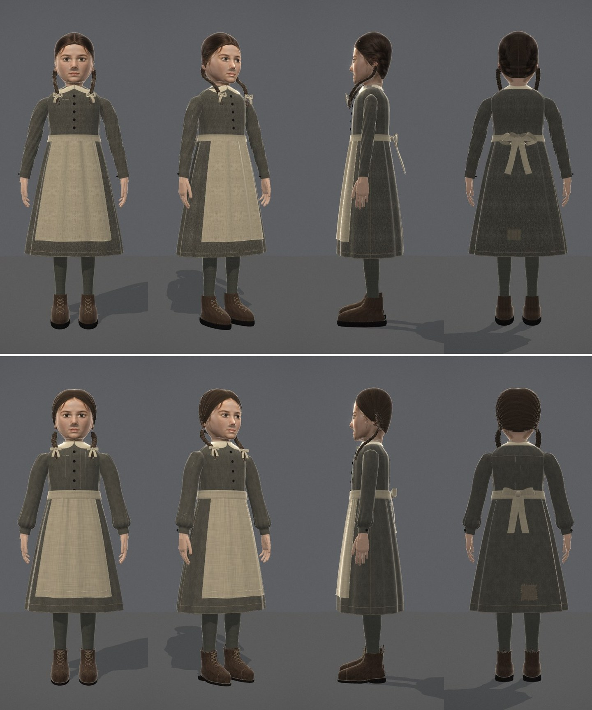
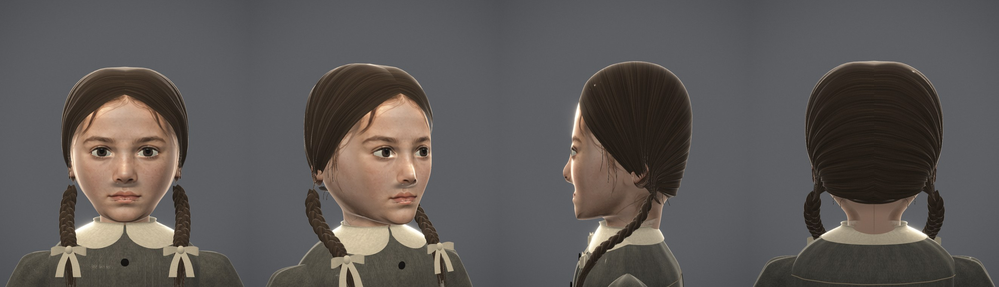
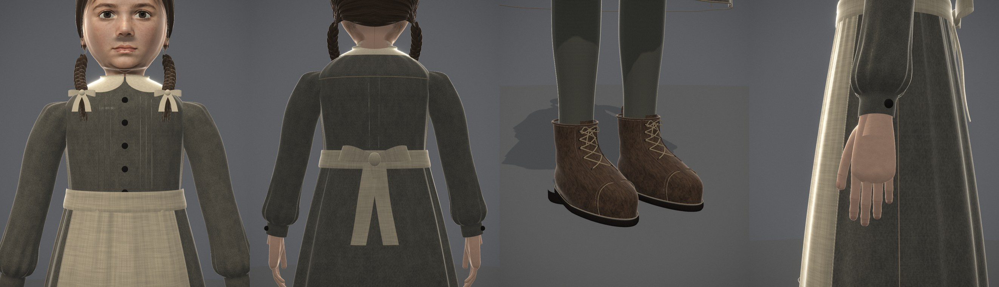
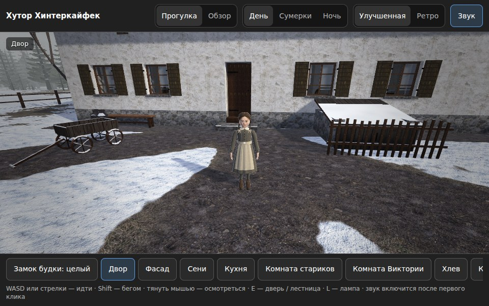
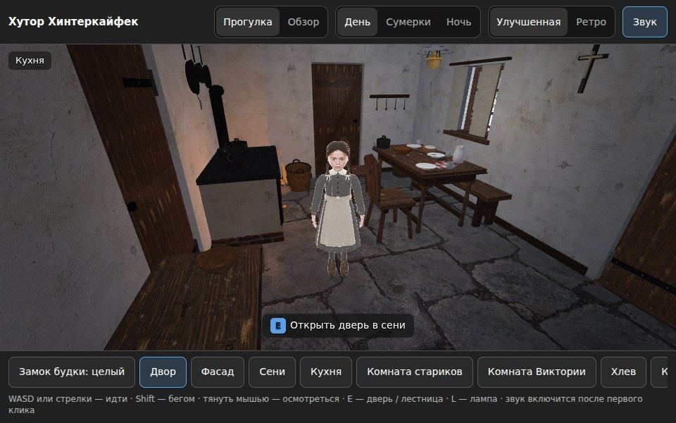

# Цецилия Габриэль — модель v02

12 ноября 2026 года. Доработка рабочей модели v01 по тому же одобренному листу `assets/concepts/characters/caecilia_gabriel_concept_v01.png`. Концепт не менялся. v01 сохранена и воспроизводится байт-в-байт: `node tools/caecilia_gabriel_bake_v01.mjs`.

**Статус: техническая доработка, не принята пользователем.** Сходство лица ограничено тем же, чем в v01: сетка лица и её текстура не менялись.





## Что изменено

| Часть | v01 | v02 |
|---|---|---|
| Волосы | гладкая «шапка» с текстурой, спроецированной с листа; сзади — нарисованные косы | объёмная оболочка от прямого пробора к узлам за ушами, рельеф прядей, направление текстуры вдоль волос; пробор виден спереди и сзади |
| Косы | три круглые нити, висящие перед грудью в воздухе | плоские пряди настоящего трёхпрядного плетения; начинаются за мочкой уха, лежат на воротнике и плече, бант на уровне воротника, ниже — свободный хвост |
| Воротник | две жёсткие остроугольные пластины | круглый отложной воротник из двух половин, лежит на скате плеч, сзади сплошной |
| Рукава | тонкая трубка | полный рукав с лёгкой сборкой у оката и напуском над манжетой; пуговица манжеты на внешней задней стороне обеих рук (в v01 одна смотрела внутрь) |
| Лиф | гладкий | по три защипа с каждой стороны планки; сзади шов кокетки и встречная складка; плоские пуговицы с бортиком |
| Юбка | 12 одинаковых волн | неравномерные складки, мелкая сборка под поясом |
| Фартук | гладкое полотно, пояс 2,7 см | сборка в пояс 3,5 см, двойная строчка подгиба, бант с петлями и двумя концами |
| Заплата | на левой стороне | на правой стороне сзади, как на листе; ручные стежки по краю |
| Ботинки | эллипсоид на чёрной плите 2,3 см | носок с отрезным швом, язычок, берцы, пять пар люверсов, шнурок с бантом, задний ремень с петлёй, рант, тонкая подошва и низкий наборный каблук |
| Чулки | тонкие цилиндры | форма икры, складки над ботинком |
| Текстуры ткани | зеркальная плитка 51-пиксельного образца (узоры-«калейдоскопы») | бесшовные генерируемые плитки: саржа, полотно, резинка 1×1, кожа, волосы, кожа рук; базовые цвета те же |
| Нормали глаз | нулевые на полюсах сферы | аналитические |

Не менялись: сетка головы и шеи (`headSDF`), текстуры `face`, `eye`, `ear` (пиксель в пиксель совпадают с v01), кисти, поза, опорные высоты (рост 1,22 м, подол 0,292, низ фартука 0,353, запястье, манжета).

## Цифры

| | v01 | v02 |
|---|---|---|
| Части | 66 | 74 |
| Треугольники | 489 070 | 492 326 |
| Вершины | 255 069 | 257 216 |
| Грани, развёрнутые против нормалей | 1 091 | 298 |
| Неединичные нормали | 4 | 0 |
| GLB | 16,2 МБ | 17,1 МБ |

Лицо по-прежнему занимает 246 462 треугольника — половину модели. Это уровень остальных персонажей проекта (Виктория v12 — 604 940, Цецилия-старшая v06 — 559 262), но для игровой сцены нужен LOD.

## Проверка

```sh
node --test tests/*.test.mjs                      # 35/35
node tools/caecilia-gabriel-mesh-check.mjs        # сводка по сетке, 0 дефектов
node tools/build.mjs caecilia-gabriel qa/NEW/build
node tools/caecilia-gabriel-farm-check.mjs qa/NEW/farm   # модель в настоящей сцене хутора
```

`caecilia-gabriel-farm-check.mjs` собирает неизменённый хутор вместе с загрузчиком `src/models/caecilia_gabriel.js`, ставит модель во дворе и на кухне на пол, который возвращает `farm.floorAt`, и проверяет рост 1,22 м, опору подошв, отсутствие ошибок и внешних запросов. Это проверка совместимости; в выдаваемую сборку хутора персонаж не добавлен.




## Порядок пересборки

`node tools/caecilia_gabriel_atlas.mjs` → `python tools/caecilia_gabriel_textures.py` (нужен Pillow) → `node tools/caecilia_gabriel_bake.mjs` → `node tools/build.mjs caecilia-gabriel <новый каталог>`. Атлас головы пишется в `qa/caecilia-gabriel-v02/head-atlas.f32` и в репозиторий не входит.

## Что осталось

- Скелета, скиннинга, анимаций и LOD нет — как и у остальных персонажей проекта. Модель статична (`extras.staticPose`), волосы и одежда — отдельные жёсткие оболочки без тела под ними; для рига потребуется тело и единая сетка одежды.
- Лицо: геометрия v01. Заметная «тень под носом» — тень от носа в освещении витрины, не дефект текстуры.
- Уши — простые формы v01, частично закрыты волосами.
- На листе косы лежат то спереди (вид спереди, портрет), то сзади (вид сбоку и сзади). В модели, как и в v01, — спереди.
- Затылок ниже линии волос — кожа шеи; шов развёртки головы виден сзади на шее тонкой линией, как в v01.
